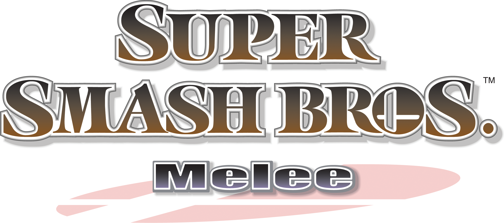
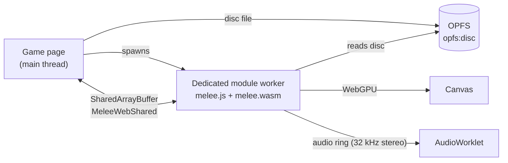

<p align="center">
  
</p>

<h1 align="center">Smash Browser</h1>

<p align="center">
  <strong>Super Smash Bros. Melee, compiled to WebAssembly and rendered with WebGPU.</strong>
</p>

<p align="center">
  Emscripten · wasm32 + pthreads · WebGPU · AudioWorklet · OPFS<br>
  <sub>Experimental. Your own Melee US 1.02 image required. No game disc included.</sub>
</p>

<p align="center">
  <a href="#how-it-works">How it works</a> &nbsp; · &nbsp;
  <a href="#build">Build</a> &nbsp; · &nbsp;
  <a href="#hosting-the-game-page">Hosting</a> &nbsp; · &nbsp;
  <a href="#status-and-limitations">Status</a>
</p>

---

Smash Browser runs the recovered Melee game code directly in the browser. There
is no emulator: the decompiled C is compiled to WebAssembly with Emscripten, and
GameCube graphics calls are translated to WebGPU by
[Aurora](https://github.com/AdamGoodApp/aurora/tree/melee-web)'s browser backend.
The player supplies their own disc image; it stays local to the browser.

## How it works



- **Engine** — `melee.js` / `melee.wasm`, built from `native/` as an ES module
  (`createMeleeModule`) for a dedicated worker. `main()` blocks the worker, so the
  pthread pool (audio mixer, ARQ worker, DVD worker) is pre-spawned.
- **Disc** — the page imports the image into OPFS before `main()` runs; the
  launcher validates `opfs:disc` and Aurora's web DVD backend reads from it.
- **Shared block** — `MeleeWebShared` in
  [`native/platform/web/web_shared.h`](native/platform/web/web_shared.h) carries
  keyboard state (SDL scancodes), four pads, page flags (hidden / focus lost /
  exit), a frame counter and the audio ring. Byte offsets are a fixed contract,
  asserted in `web_shared.c`.
- **Audio** — the mixer thread writes interleaved stereo into the ring; an
  AudioWorklet drains it and reports underruns.
- **Errors** — launch failures are posted back to the page as
  `{type: 'error', message}`.

Browser-specific code lives in [`native/platform/web`](native/platform/web);
the `MELEE_WEB` branch of [`native/CMakeLists.txt`](native/CMakeLists.txt) holds
the link configuration.

## Requirements

**To play**

- A browser with WebGPU, OPFS, module workers and `SharedArrayBuffer`
  (current Chrome / Edge; others as their WebGPU support allows).
- Your own **Melee US 1.02 disc image (GALE01, revision 2)**.

**To build**

- [emsdk](https://emscripten.org/docs/getting_started/downloads.html) **6.0.12**
- CMake 3.25+, Ninja, Python 3, Git, and a network connection (dependencies are
  downloaded at configure time)
- Node.js (runs the wasm unit tests)

## Build

From the repository root:

```sh
# 1. Toolchain
git clone https://github.com/emscripten-core/emsdk.git ~/emsdk
~/emsdk/emsdk install 6.0.12 && ~/emsdk/emsdk activate 6.0.12
source ~/emsdk/emsdk_env.sh

# 2. Dependencies: Aurora + game sources (see "Game code" below)
python3 native/tools/bootstrap.py

# 3. Engine
emcmake cmake -S native -B build/web -G Ninja -DCMAKE_BUILD_TYPE=Release
cmake --build build/web --target melee_native --parallel
```

Output: `build/web/melee.js` and `build/web/melee.wasm`. Use
`-DCMAKE_BUILD_TYPE=Debug` for `-g` and `-sASSERTIONS=1`.

WebGPU bindings come from emdawnwebgpu (google/dawn `v20260810.185610`). CMake
passes the remote port
[`native/platform/web/emdawnwebgpu.remoteport.py`](native/platform/web/emdawnwebgpu.remoteport.py)
to every compile and link via `--use-port`.

### Game code

This repository contains **no game code**. Only the browser runtime, build
configuration and docs live here. `bootstrap.py` fetches the recovered sources
(`src/` and `extern/`, based on [doldecomp/melee](https://github.com/doldecomp/melee)
with the native/wasm32 fixes) from
[AdamGoodApp/melee-native](https://github.com/AdamGoodApp/melee-native) at a
pinned commit into `build/native-deps/game`, then symlinks them at the repo root.
Both links are gitignored.

### Unit tests (wasm32)

The core tests build without Aurora or the game executable:

```sh
emcmake cmake -S native -B build/web-tests -G Ninja -DMELEE_WEB_TESTS_ONLY=ON
cmake --build build/web-tests --parallel
ctest --test-dir build/web-tests --output-on-failure
```

## Hosting the game page

The engine is loaded by a host page that implements the contract above. That
page must:

1. Be served **cross-origin isolated** so `SharedArrayBuffer` is available:

   ```
   Cross-Origin-Opener-Policy: same-origin
   Cross-Origin-Embedder-Policy: require-corp
   ```

2. Copy the user's disc image into OPFS as `disc` before starting the engine.
3. Start a dedicated **module** worker that imports `melee.js`, calls
   `createMeleeModule()`, then `callMain()`.
4. Map `melee_web_shared_block()` into the shared memory and write input,
   flags and the audio read position using the layout in `web_shared.h`.
5. Run an AudioWorklet that consumes the ring at 32 kHz.

Serve `melee.js` and `melee.wasm` from the same origin as the page, with
`application/wasm` for the `.wasm` file.

## Controls

| Key | Action |
| --- | --- |
| WASD | Move |
| X | Attack / confirm |
| Z | Special / back |
| C / V | Jump |
| Q / E | Shield |
| R | Grab |
| IJKL | C-stick |
| Return | Start / pause |

Gamepads are read by the page and forwarded through the shared pad slots.

## Status and limitations

- Experimental; expect crashes and missing features.
- No persistence: settings and bindings live in MEMFS and reset on reload.
  Saving does not work.
- WebGPU-only; no WebGL fallback.
- Not all modes, stages, characters, moves or items are verified in the browser.

When reporting a bug, include the build revision, browser and version, GPU,
reproduction steps and the worker console output. Do not attach game assets.

<details>
<summary>Source layout</summary>

```text
src/, extern/              Game sources, fetched by bootstrap (not committed)
native/                    Runtime shared by all targets
  platform/web/            Browser launcher, shared block, audio host
  tools/                   Bootstrap and SDK preparation
  tests/                   Unit tests (wasm32 via MELEE_WEB_TESTS_ONLY)
```

The native macOS / Linux runtime code is still present because the browser
target shares it.

</details>

## Credits and notices

The recovered game code fetched at build time comes from the contributors to
[doldecomp/melee](https://github.com/doldecomp/melee). The shared native runtime
builds on [melee-native](https://github.com/jonrosner/melee-native). Graphics use
[Aurora](https://github.com/encounter/aurora) and Dawn's emdawnwebgpu.
Third-party notices are kept in [native/licenses](native/licenses).

This repository distributes no game code, disc image, extracted game assets or
console firmware.
